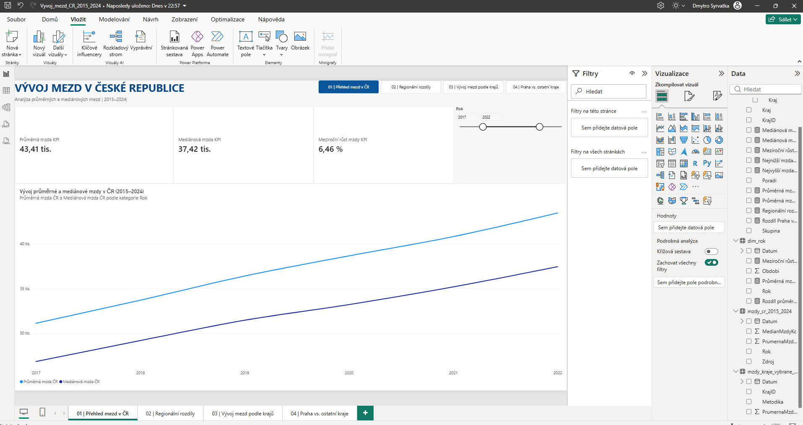

# Vývoj mezd v České republice (2015–2024)

Závěrečný projekt ENGETO – Power BI. Interaktivní analytický report sleduje vývoj **nominálních hrubých měsíčních mezd** v České republice, porovnává průměr a medián a ukazuje rozdíly mezi kraji, zejména mezi Prahou a ostatními regiony.

## Power BI report

Soubor: **[`Vyvoj_mezd_CR_2015_2024.pbix`](Vyvoj_mezd_CR_2015_2024.pbix)**. Pro interaktivní prohlížení je potřeba Power BI Desktop na Windows. Screenshoty jednotlivých stránek jsou ve složce [`screenshots`](screenshots/).

| Stránka | Obsah |
|---|---|
| 01 – Přehled mezd v ČR | Vývoj průměrné a mediánové mzdy, KPI, meziroční růst, filtr let |
| 02 – Regionální rozdíly | Porovnání 14 krajů, krajní hodnoty, rozdělení Praha / ostatní kraje |
| 03 – Vývoj mezd podle krajů | Srovnání krajů v čase, výběr krajů, matice s hierarchií skupina → kraj |
| 04 – Praha vs. ostatní kraje | Průměrné krajské mzdy podle skupin, rozdíl v Kč, vývoj rozdílu v čase |

Součástí reportu jsou propojené datové tabulky, DAX míry, kalkulovaný sloupec `Typ regionu`, průřezy, více typů vizualizací a navigace mezi stránkami.



## Data a zdroje

Všechny vstupní CSV soubory jsou ve složce [`data`](data/), oddělené středníkem a kódované UTF-8.

- **Národní řada (2015–2024):** `mzdy_cr_2015_2024.csv` – roční průměrná a mediánová mzda; strukturální mzdová statistika ČSÚ zprostředkovaná veřejným portálem Stats.cz. [Přehled průměrné mzdy](https://www.stats.cz/prace-a-ekonomika/mzda-prumer/), [přehled mediánu](https://www.stats.cz/prace-a-ekonomika/mzda-median/), [ČSÚ](https://csu.gov.cz/produkty/prumerna-hruba-mesicni-mzda-a-median-mezd-v-krajich).
- **Krajská řada (2015 a 2020–2024):** `mzdy_kraje_vybrane_roky.csv` – průměrná mzda pro 14 krajů; údaje ČSÚ přebírané z [Ročenky dopravy 2025, tab. 2.4.5](https://www.sydos.cz/cs/rocenka-2025/rocenka/htm_cz/cz25_245000.html).
- **Dimenze:** `dim_kraj.csv` a `dim_rok.csv` – přehled krajů a let používaný pro filtrování a hierarchii.

### Metodická omezení

1. Národní **strukturální** mzdová řada a **krajská** mzdová řada pocházejí z odlišných statistických šetření a nelze je interpretovat jako zcela srovnatelnou jednu řadu.
2. V krajských datech nejsou roky **2016–2019**. Spojnicové grafy mezi existujícími roky mohou působit jako souvislá čára, ale neznamená to, že byly pozorovány všechny mezilehlé hodnoty.
3. Jde o **nominální** částky bez očištění o inflaci.
4. „Ostatní kraje“ na čtvrté stránce znamenají **nevážený průměr krajských hodnot**; nejde o průměrnou mzdu všech zaměstnanců mimo Prahu ani o celostátní mzdu.
5. Výsledek je určen jako deskriptivní vizualizace; z rozdílů nelze bez další analýzy usuzovat na jejich příčiny. Metodické poznámky jsou také v [`docs/DATOVA_METODIKA.md`](docs/DATOVA_METODIKA.md).

## Vybrané výsledky

Ve výchozím zobrazení stránky 04 (rok 2024) je průměrná mzda Prahy **57,9 tis. Kč**, nevážený průměr ostatních 13 krajů **42,0 tis. Kč** a jejich rozdíl **15,91 tis. Kč** (zobrazené hodnoty jsou zaokrouhlené). Výstup lze procházet prostřednictvím navigace mezi čtyřmi stránkami.

## Struktura repozitáře

```text
PowerBI_Project/
├── Vyvoj_mezd_CR_2015_2024.pbix
├── README.md
├── data/
│   ├── dim_kraj.csv
│   ├── dim_rok.csv
│   ├── mzdy_cr_2015_2024.csv
│   └── mzdy_kraje_vybrane_roky.csv
├── screenshots/
│   ├── 01_stranka.png
│   ├── 02_stranka.png
│   ├── 03_stranka.png
│   └── 04_stranka.png
└── docs/
    └── DATOVA_METODIKA.md
```

## Poznámka k reprodukovatelnosti

Soubor PBIX obsahuje report a datový model s uloženými daty. Při aktualizaci zdrojů v Power BI Desktop může být potřeba upravit místní cesty k CSV souborům na nové umístění složky `data`. Report nebyl zveřejněn v Power BI Service; k prohlížení slouží projektový soubor PBIX.
